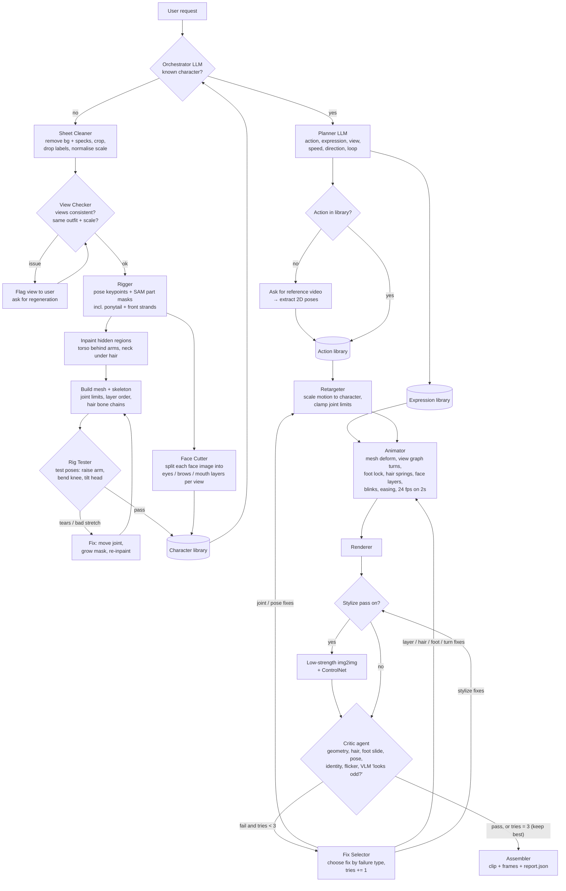

# Spec — Drift-Free 2D Character Animation Agent (UMC301 Project 3)

Author: Archana Yadav
Duration: 10 days
Status: Draft v3.5 (rig-based; mirroring allowed for right-facing views; layered faces; 24 fps on 2s; local open-source LLM/VLM; deployed on HF Spaces)

---

## 1. Problem
- I have an AI-generated character for my story.
- AI video tools redraw the character every frame → **face, hair and clothes drift**, and it flickers.
- Hand-animating is too slow for a beginner.

## 2. Goal
An agent that takes **my character** + **an action request** and returns a smooth 2D clip, **with zero identity drift**.

```
animate("protagonist", "wave", expression="smile")  → wave.mp4
"make her look down sadly, slowly"                  → look_down.mp4 (sad, speed 0.7)
```

## 3. Core idea
- **Don't redraw the character. Rig it.**
- Cut the character into parts once → build a 2D mesh + skeleton → move the parts.
- Every pixel comes from my images, so the character **cannot drift**.
- Optional AI "redraw" pass adds a hand-drawn feel; the critic guards it.

### 3.1 Related work

| Approach | Examples | What it does well | Why it doesn't solve my problem |
|---|---|---|---|
| AI image-to-video | Stable Video Diffusion, commercial video generators | realistic motion from one image | redraws every frame → face/hair/clothes drift, flicker; no control over exact pose |
| Consistency add-ons for diffusion | IP-Adapter, character LoRA, AnimateDiff | reduce drift | still regenerate pixels → drift is reduced, not removed; LoRA needs training |
| Portrait / talking-head animation | LivePortrait-style face reenactment | very good face motion | head only — no body, hands, walking, turns |
| Manual 2D rigging tools | Live2D Cubism, Spine, Adobe Character Animator, Toon Boom Harmony | zero drift, industry standard | an artist must cut every layer and build the rig by hand (hours–days) |
| Automatic rigging of a drawing | Meta Animated Drawings (Smith et al., 2023) | auto-rigs one drawing from a single image | one view only, no turns, no face expressions, no hair physics, no self-check — built for children's drawings |
| Shape deformation | ARAP (Igarashi et al., 2005) | natural-looking bending of 2D shapes | a technique, not a system — used inside my Animator |
| LLM agents with tools + self-critique | ReAct-style tool use, Reflexion-style self-correction | plan, act, check, retry | not applied to character animation; usually need large models |

**Gap:** nothing turns an *AI-generated character sheet* into a *drift-free, multi-view, expressive* animation *automatically*, from *plain language*, and *checks its own output*.

| | Zero drift | No manual prep | Multi-view / turns | Expressions | Plain-language requests | Self-check + fix |
|---|---|---|---|---|---|---|
| AI image-to-video | ✗ | ✓ | ~ | ~ | ✓ | ✗ |
| Manual rigging tools | ✓ | ✗ | ✓ | ✓ | ✗ | ✗ |
| Animated Drawings | ✓ | ✓ | ✗ | ✗ | ✗ | ✗ |
| **This project** | ✓ | ✓ | ✓ (view swaps) | ✓ (layered faces) | ✓ | ✓ |

### 3.2 Contributions
1. **Automatic onboarding of AI-generated characters:** sheet cleaning, view-consistency checking, part + hair masks, inpainting of hidden areas, mesh + skeleton with hair chains, and layered faces cut from expression edits — no manual masking (Rigger + Rig Tester loop).
2. **An agent, not a pipeline:** natural-language planning, and a critic that labels the failure type so the Fix Selector re-runs the right stage (max 3 tries, every decision logged).
3. **Motion that transfers:** actions stored as skeleton motion only → a new character gets every action with zero new animation work (reuse test).
4. **Small-model design:** the whole agent runs with free open models (3B LLM, small VLM) on a laptop CPU, because code does all computable work and the models only make constrained choices (11.2).
5. **Measured evidence:** identity drift, flicker, artifacts, foot sliding and blind human ratings against an AI-video baseline and Animated Drawings (Section 14).

**Not claimed:** inventing 2D rigging, ARAP deformation, or true 3D turns. Motion is 2D puppet-style with view swaps; known limits are listed in Section 17.

**One-line pitch:** *AI can draw my character, but it can't keep her the same across a video. I built an agent that rigs AI-generated characters automatically, animates them from plain-English requests, and checks and fixes its own output — so the character never drifts.*

## 4. Character design decisions
- **Hairstyle: curly side ponytail** + a few loose curls near the face.
  - Neck and shoulders stay visible → cleaner rigging, less inpainting.
  - Ponytail = one bone chain with spring physics; loose strands = small springs.
- **Mirroring allowed:** 3/4 right and side right are mirrored from 3/4 left and side left.
  - Trade-off: the ponytail flips shoulder in mirrored views. Accepted, since it's barely noticeable in short clips.
  - Never cut directly between a view and its mirror. Turns follow the view graph (Section 10.1), which enforces this.
- **Faces are layered:** eyes, brows and mouth are separate layers on the head, so blinks work on top of any expression (Section 8.3).
- Outfit: white tee, blue wide-leg jeans, white sneakers. Flat colours, cream background.
- Loose-curly-hair version = second variant for the reuse test (Section 14).

## 5. Scope
**In scope**
- 1 character (protagonist, ponytail version)
- Core actions: `idle`, `wave`, `look_down`, `walk` (side), `turn` (view swap)
- Stretch actions: `nod`, `search_pockets`, `sit_down`
- Core expressions: neutral, blink, smile, sad, shocked
- Secondary motion: ponytail + strand springs, breathing, auto-blinks
- Plain background, 512×768
- **Timing: 24 fps output, animated on 2s** (each pose held 2 frames → 12 poses/s). Hair springs and blinks are also stepped on 2s so everything moves in sync.
- Runs on free Colab/Kaggle T4 for image models; rig, animation and the agent's LLM/VLM run on a laptop CPU (16 GB RAM, no GPU)

**Out of scope (future work)**
- Backgrounds, props, multi-character scenes, lip sync, camera moves, full 3D turns

## 6. Inputs / Outputs

| | Item | Format |
|---|---|---|
| In | Turnaround | PNG: front, 3/4 L, side L, back (3/4 R + side R mirrored in code) |
| In | A-pose | PNG: front + side, arms ~25° out |
| In | Expression sheet | PNG full-body edits (only face changed): front (full set), 3/4 L and side L (small set) — see Section 13 |
| In | Hand sheet | PNG, same scale/angle as body views |
| In | Request | action name or natural-language text |
| In (optional) | Reference video | 2–5 s clip for a new action |
| Out | Clip | .mp4 / .gif (24 fps) |
| Out | Frames | PNG sequence (transparent bg) |
| Out | Report | report.json: plan, critic scores, fixes tried, which stage each fix re-ran |

---

## 7. Agentic system — flowchart



### Plain-text version
```
REQUEST
  │
  ▼
ORCHESTRATOR ── new character? ──► ONBOARDING (once)
  │                                  Clean → Check views → Rig (+ hair chains, face layers)
  │                                  → Test rig ⟲ fix → Character library
  ▼
PLANNER (LLM): text → {action, expression, view, speed, direction, loop}
  │
  ├─► ACTION LIBRARY: hit? ── no ──► ask for video → extract poses → save
  └─► EXPRESSION LIBRARY: recipe → this character's face layers for this view
  │
  ▼
RETARGET → ANIMATE → RENDER → (optional STYLIZE)
  │
  ▼
CRITIC ── fail ──► FIX SELECTOR ──► re-run from the affected stage (max 3 tries)
  │                 joint/pose → Retarget · layer/hair/foot/turn → Animate · stylize → Stylize
 pass (or 3 tries → keep best, flag in report)
  ▼
ASSEMBLE: clip + frames + report.json
```

---

## 8. Libraries

### 8.1 Character library (one folder per character) — how she *looks*
```
characters/protagonist/
├── views/        front, 3q_left, side_left, back (+ mirrored 3q_right, side_right)
├── apose/        front, side
├── rig.json      skeleton, mesh, joint limits, layer order, hair chains
├── parts/        cut-out body parts (PNG)
├── faces/        one folder per view: front/, 3q_left/, side_left/ (right views mirrored)
│   └── <view>/   head_base.png + eyes/ brows/ mouth/ layers (cut by Face Cutter)
├── hands/        open, relaxed, fist
└── info.json     name, proportions, palette, hairstyle, available face layers per view
```

### 8.2 Action library (shared) — only *motion*, no images
```
actions/wave/
├── motion.json   joint angles per frame on a standard skeleton (+ foot contact flags)
├── meta.json     view, loopable, default speed, fps
└── sources.md    where the motion came from + licence
```
- Stored as joint angles, not pixels → **works for any humanoid character**.
- Retargeter scales it to each character's proportions.
- Limits: very different body shapes need smaller motion range; non-humans need a different skeleton.

### 8.3 Expression library — layered faces, split in two
- **Art (per character, per view):** `characters/<name>/faces/<view>/`
  - I generate **whole-head images** (easy to keep consistent with an image generator).
  - Onboarding's **Face Cutter** aligns each one to the neutral head (face landmarks) and cuts out the **eyes, brows and mouth** regions as separate layers.
  - Result: `eyes/{open, half, closed, down, wide}`, `brows/{neutral, down, raised, worried}`, `mouth/{neutral, smile, small, open}` (whatever the source images provide).
- **Recipes (shared):** `expressions/recipes.json` — each expression is a choice of layer per region:
  ```json
  "sad": { "eyes": "down", "mouth": "small",
           "brows": "down", "blink_rate": "slow" }
  ```
- "sad" → agent reads the recipe → picks *this* character's layers for the *current view*.
- **Blink** = temporarily swap only the eyes layer (open → half → closed → half → open), so it works on top of any expression.
- **Fallback:** if a layer is missing for a view (e.g. no `smile` mouth in side view), use that view's neutral layer and log it in report.json. The Planner is told which expressions each view supports.

---

## 9. Actions and expressions

### 9.1 Actions

| Action | View | Story use | Motion source | Priority |
|---|---|---|---|---|
| idle (breathing, blink, hair) | front | between shots | code keyframes | core |
| wave | front | bye to mom | own video / Pexels | core |
| look_down | front / 3/4 | sad moment | code keyframes | core |
| walk | side | roadside scene | Mixamo (+ foot lock) | core |
| turn | view swap | connects shots | view graph (10.1) | core |
| nod | front | dialogue | code keyframes | stretch |
| search_pockets | front | lost-phone moment | own video | stretch |
| sit_down | side | study table | Mixamo | stretch |

### 9.2 Expressions

| Expression | Views supported | Used in |
|---|---|---|
| neutral | front, 3/4, side | idle, walk |
| blink | front, 3/4, side (automatic) | everywhere |
| smile | front | wave |
| sad | front, 3/4 | look_down |
| shocked / worried | front | realising the phone is lost |

### 9.3 Demo combos
- wave + smile
- look_down + sad
- idle → shocked
- walk + neutral with blinks (side view)
- turn front → side left (via 3/4 left)

### 9.4 Motion sources and licences
- **Own phone video:** fully mine.
- **Pexels / Pixabay:** free to use and modify.
- **Mixamo:** free, royalty-free in own projects (3D skeleton → projected to 2D).
- **Code keyframes:** for simple actions (nod, look_down, idle).
- Avoid random YouTube/Instagram clips and non-commercial research datasets (film may be released later).
- Every action folder keeps a `sources.md` (link, licence, date).

---

## 10. Hair handling and turns

### 10.1 Turns (view graph)
```
side_R ── 3q_R ── front ── 3q_L ── side_L ── back
```
- A turn steps through **adjacent views only** (e.g. front → 3q_L → side_L), one view change per held pose, with a short cross-fade on the head.
- A view is never followed directly by its mirror; turns that go through `back` use the left chain (`side_L ↔ back`), since the back view is drawn, not mirrored.
- If the critic says a turn looks jumpy, the fix is to hold the in-between view for longer (more frames).

### 10.2 Ponytail
- Segment hair into: **head hair** (fixed to head), **ponytail** (bone chain, 3 bones), **front strands** (1–2 short chains).
- Inpaint neck/shoulder under the ponytail.
- Spring physics: ponytail follows head with delay (follow-through); curly hair → more bounce, less sway.
- Pin chain roots to the head bone → hair never detaches.
- Keep spring strength low; increase slowly (big motion looks like jelly).
- Turns: hair comes from the new view image, no physics needed.

### 10.3 Feet (walk, sit_down)
- `motion.json` marks frames where each foot is on the ground.
- During contact the Animator **locks the foot** in place and solves the leg with 2-bone IK → no foot sliding.

---

## 11. Agents and tools

| Agent | Type | Job | Tools it calls |
|---|---|---|---|
| Orchestrator | code + small LLM | routes request, holds state, onboarding vs animate | library lookup |
| Sheet Cleaner | code (no model) | clean bg, crop, normalise scale; faces reuse their view's transform | border flood-fill stopped by outlines, trapped-pocket removal, colour unmixing for halo, connected components |
| View Checker | rules + small VLM | catch inconsistent views; create mirrored views | DINOv2 sim, colour/height stats, VLM yes/no questions, flip |
| Rigger | tool chain | keypoints, part + hair masks, inpaint, mesh | DWPose, SAM, SD inpaint, Delaunay mesh |
| Face Cutter | tool chain | align face images, cut eyes/brows/mouth layers per view | face landmarks, SAM, alignment |
| Rig Tester | rules | stress-test rig, propose fixes | test-pose renders, stretch metrics |
| Planner | rules first, small LLM fallback | text → {action, expression, view, speed, direction, loop} JSON | keyword parser, JSON-schema constrained decoding, library enums |
| Retargeter | code | motion → rig angles, joint limits | numpy |
| Animator | code | ARAP mesh deform, view-graph turns, foot lock (IK), hair springs, face layers | own code (ref: Animated Drawings) |
| Stylizer (opt.) | diffusion | hand-drawn feel | SD 1.5 img2img + ControlNet |
| Critic | metrics + small VLM | score frames, label failure type | DINOv2, LPIPS, rig joint error, VLM yes/no questions |
| Fix Selector | rules (no LLM) | pick fix for failure + stage to re-run | see 12.2 |

### 11.1 Models (all free, open source, run locally)

| Role | Model | Runs on |
|---|---|---|
| Planner / Orchestrator (text) | `qwen2.5:3b` via Ollama (upgrade to `qwen2.5:7b` only if JSON accuracy < 95% on the test set) | laptop CPU |
| View Checker / Critic (vision) | small VLM via Ollama, e.g. `qwen2.5vl:3b` or `gemma3:4b` (pick the better one on the critic tuning set) | laptop CPU |
| Backup VLM | Qwen2.5-VL 7B (4-bit) | Kaggle T4 |

- All model calls go through one interface (`src/agent/llm.py`) with swappable backends (Ollama / Kaggle / API), fixed model versions, temperature 0 and a response cache → reproducible results.
- Character art never leaves the machine (film may be released later).

### 11.2 Designing for small models
The rule: **code does everything that can be computed; the model only does what needs language or vision judgement — and only as a constrained choice.**

1. **Rules first, model second.** The Planner runs a keyword/synonym parser first ("sadly" → sad, "slowly" → speed 0.7, "wave" → wave). The LLM is called only for slots the parser could not fill. Most demo requests never reach the LLM.
2. **Choose, don't write.** The model never invents names: every field is an enum built from the libraries (actions, expressions available *in that view*, views). Output is forced with JSON-schema constrained decoding (Ollama `format`).
3. **Validate → repair → fall back.** Parse and check against the library; on error, send back the one specific error ("'sad' is not available in side_left; choose from [neutral, blink]") and retry once; then fall back to rule defaults and log it.
4. **Short prompts, few-shot.** Each call has one small task, 3–5 worked examples, and only the options relevant to it — no long system prompts.
5. **Narrow vision questions, not "does this look odd?".** The VLM gets several specific yes/no questions, each with the reference view beside the frame, e.g. "Is any arm or hand detached from the body?", "Is the ponytail floating away from the head?", "Is the face missing or doubled?". Answers are combined by vote.
6. **Show the model what matters.** Code prepares the input: contact sheet of 6 key frames, crops of the region that metrics flagged, reference image next to it. Small VLMs see small images better when they are cropped.
7. **Model is one vote.** Metrics decide pass/fail; the VLM can only add a failure label with a reason. A wrong VLM answer cannot reject a clip that all metrics pass, unless 2 of 3 questions agree.
8. **Measure it.** A 40-request planner test set and the hand-labelled critic set score each model; the report shows accuracy for rules-only, small LLM, and rules + small LLM.

---

## 12. Critic

### 12.1 Checks

| Check | Metric | Threshold |
|---|---|---|
| Geometry | max triangle stretch / area change | ≤ τ_geo |
| Hair | chain root attached to head; clump stretch | ≤ τ_hair |
| Foot slide | foot drift (px) during marked contact frames | ≤ τ_foot |
| Pose | **rig joint positions** vs retargeted target pose (exact, no detector needed); DWPose on the render only as a secondary sanity check, since it is noisy on anime proportions | ≤ τ_pose |
| Identity | DINOv2 cosine sim to matching view | ≥ τ_id (mainly with stylize) |
| Flicker | LPIPS between consecutive *distinct* poses (held frames skipped) | ≤ τ_flicker |
| "Looks odd" | VLM: 3–5 targeted yes/no questions on a contact sheet + flagged crops, reference view beside it (11.2) | majority "no" |

- A basic metric-only critic (geometry, hair, foot, pose; log-only) runs from Day 6 so every clip gets scored.
- Thresholds are tuned on **Day 8** using ~10 hand-labelled good/odd clips made by the pipeline on Days 3–7.

### 12.2 Failure → fix (the agent's decision)

| Failure | Fix chosen | Re-runs from |
|---|---|---|
| Limb over-stretched / mesh tear | clamp joint angle, reduce motion amplitude | Retargeter |
| Pose error high | re-retarget with scaled bone lengths | Retargeter |
| Wrong part in front (layer order) | swap layer order for those frames | Animator |
| Hair too wobbly / detached | lower spring strength, re-pin root | Animator |
| Foot sliding | tighten foot lock / extend contact window | Animator |
| Turn looks jumpy | hold in-between view longer | Animator |
| Flicker (stylize on) | lower img2img strength, reuse seed | Stylizer |
| Identity drop (stylize on) | lower strength → if still bad, skip stylize | Stylizer |
| Still failing after 3 tries | keep best-scoring version, flag in report | — (Assembler) |

---

## 13. Data to prepare

| Item | Count | Notes |
|---|---|---|
| Turnaround | 4 | front ✅, 3/4 L, side L, back (right views mirrored) |
| A-pose | 2 | front ✅ done, side |
| Face images — front | 8 | neutral, eyes_half, eyes_closed, eyes_down, smile, sad, shocked, worried |
| Face images — 3/4 L | 3 | neutral, eyes_closed, sad (eyes down) |
| Face images — side L | 2 | neutral, eyes_closed |
| Hands | 1 (+1 later) | relaxed front/side = the view images themselves; `open_front` ✅ (wave), `fist_front` ✅ — both on her **left hand** (viewer's right), so she waves with her left hand. Hand swaps are cut at the wrist and rotated to match the rig's forearm angle (edits may rotate the forearm a few degrees) |
| Motion clips | 1 per action | Mixamo / Pexels / own video / keyframes |
| Critic tuning set | ~10 clips | produced by the pipeline Days 3–7, hand-labelled good / odd |
| palette.json + prompt.txt | — | colours + generation prompt for the report |

Neutral faces = the body views themselves, so **10 face images** to generate. Each face image is a **full-body edit of its view image with only the face changed** (head must not move) → faces are pixel-aligned for the Face Cutter.

---

## 14. Evaluation

**Systems compared**
1. Baseline A: Meta Animated Drawings (same character image)
2. Baseline B: Stable Video Diffusion img2vid (fp16, fits a free T4); fallback if it won't fit: AnimateDiff + SD 1.5 + IP-Adapter
3. Ours, no critic
4. Ours + critic
5. Ours + critic + stylize

**Objective**
- Identity drift over time (DINOv2 sim vs views, per frame)
- Flicker (LPIPS between distinct poses)
- Geometry artifacts (% frames with over-stretch)
- Foot sliding (px drift during contact, walk only)
- Pose accuracy (rig joint error)
- Critic effect: scores before vs after fixes

**Subjective**
- 8–10 raters, blind, random order
- Rate 0–100: looks like the character · smooth · not odd
- Report mean ± 95% CI; check if ratings agree with metrics

**Ablations**
- Rigid parts vs mesh deformation
- With / without secondary motion (hair, breathing, blinks)
- With / without foot lock (walk)

**Setup cost vs clips (effort argument)**
- One-time input per character: ~17 images (4 views + ~11 faces + 1–2 hands), all AI edits, no hand-cut layers.
- Chart: cumulative human effort (images made / generations used) vs number of clips, for: hand animation (~12 drawings/s), AI video (≥1 generation per clip, more with retries), manual rigging (hand-cut layers), and this agent (flat after onboarding).
- Report the break-even point: number of clips after which the agent is cheaper than AI video.

**Reuse test**
- Onboard the loose-curly-hair variant → run all actions with zero new motion work.

---

## 15. Acceptance criteria
- Onboarding turns my images into a working rig and face layers with no manual masking
- `animate()` works for the 5 core actions
- 5 core expressions work via recipes in the views listed in 9.2 (fallbacks logged)
- Natural-language request → correct structured call (≥ 95% on the planner test set, local model)
- Unknown action → asks for video and adds it to the library
- Critic + fix loop runs, re-runs the right stage, and logs every decision
- **Ours + critic + stylize** has lower identity drift than Baseline B (non-overlapping 95% CIs); rig-only systems reported as the ≈zero-drift reference
- Human "not odd" score higher than Baseline A
- Reuse test: second variant animates with existing actions
- Demo video + failure-case analysis
- **Deployed** web app reachable from the examiner's computer; transcript HTML submitted (15.1)

### 15.1 Deployment (viva requirement — submit URL + transcript before **27 Oct 2026, 2 pm**)
- **Web app:** Gradio UI — type a request ("make her look down sadly, slowly") → shows the plan JSON, the clip, critic scores and fixes tried (report.json). Also lists available actions/expressions, and lets the user upload a reference video for an unknown action.
- **Hosting:** Hugging Face Spaces, free CPU tier (public URL). Fallback: run on the laptop and share over the LAN (intranet).
- **What runs live (CPU):** Planner (rule parser + small LLM via llama.cpp/Ollama in the container), Retargeter, Animator, Renderer, metric Critic, Fix Selector, Assembler.
- **Precomputed offline (GPU on Kaggle):** onboarding outputs (character library: rig, parts, face layers), baselines, stylize examples. The app shows the onboarding results and logs; the onboarding pipeline itself is demonstrated from notebooks.
- **Slow parts are optional in the live app:** VLM critic and stylize behind a "deep check" toggle, with pre-rendered examples so the demo never waits minutes.
- **Never-fail demo:** response cache + pre-rendered clips for the demo combos (9.3), so the app still works if the Space is cold or the LLM is slow.
- **Transcript:** keep using the same Claude Code session; at the end run `/export` → transcript.md → converter script → standalone `transcript.html` (Turn 1, 2, 3 … with each response in a collapsed block).

---

## 16. Timeline (10 days)

| Day | Work | Checkpoint |
|---|---|---|
| 1 | Generate turnaround, A-pose side, face images (3 views), hands; collect motion clips | Assets ready |
| 2 | Sheet Cleaner + View Checker + keypoints + SAM part/hair masks | |
| 3 | Inpaint hidden parts, mesh + skeleton, one wave clip | First clip |
| 4 | Rig Tester + auto-fix loop; ponytail chain; Face Cutter | Onboarding done |
| 5 | Action library, retargeter, walk (+ foot lock) / look_down / idle | |
| 6 | Expression recipes + blinks, hair springs, turn via view graph; basic metric critic (log-only) | |
| 7 | Planner (rule parser + local LLM, constrained JSON) + Orchestrator; planner test set; **first Gradio app deployed to HF Spaces** | End-to-end + live URL |
| 8 | Full Critic (identity, flicker, VLM) + tune thresholds on labelled set + Fix Selector with stage routing; optional stylize | Self-fixing loop |
| 9 | Reuse test; baselines, metrics, human ratings | |
| 10 | Final deploy + pre-rendered demo clips; transcript export → HTML; demo, slides, viva prep | Submit URL + transcript |

---

## 17. Risks

| Risk | Likelihood | Mitigation |
|---|---|---|
| Inconsistent views from image generator | Medium | View Checker; regenerate with A-pose as reference |
| Bad part masks on anime proportions | Medium | A-pose input, SAM with keypoint prompts, Rig Tester loop |
| Face layers misaligned between images | Medium | align to neutral head with landmarks; flat colours hide small seams |
| Inpainted hidden areas look wrong | Low–Med | flat colours; moderate arm motion |
| Looks "puppet-y" | Medium | mesh deform, on-2s timing, easing, secondary motion |
| Ponytail looks rubbery | Medium | low spring strength, stretch limit in critic |
| Foot sliding in walk | Medium | contact flags + foot lock IK; foot-slide check in critic |
| Baseline B won't fit on T4 | Medium | fp16 + small decode chunks; fallback AnimateDiff |
| sit_down needs bent legs | High | stretch goal; side view only |
| VLM judge unreliable | Medium | one vote, not the only check; targeted yes/no questions; Kaggle 7B backup |
| Small LLM misreads requests | Medium | rule parser first, enum-only constrained JSON, validate-and-retry, planner test set |
| Time | Medium | end-to-end by Day 7 |
| Deployment fails / free Space too slow | Medium | deploy early (Day 7), rules-first planner, cached + pre-rendered clips, LAN fallback |

---

## 18. Future work
- Lip sync from audio (mouth layer swaps — already supported by layered faces)
- Props attached to hand joints (e.g. phone)
- Backgrounds + scene compositing
- Story script → shot list → clips (scene mode)
- More hairstyles / outfits per character
- More face images for 3/4 and side views (smile, shocked)

## 19. Why build it
- Real need: I want to animate my own story.
- AI video tools drift; rigging guarantees consistency.
- Learn to design an agentic system end to end: planning, tool use, self-checking, and fixing.
